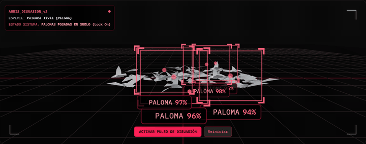
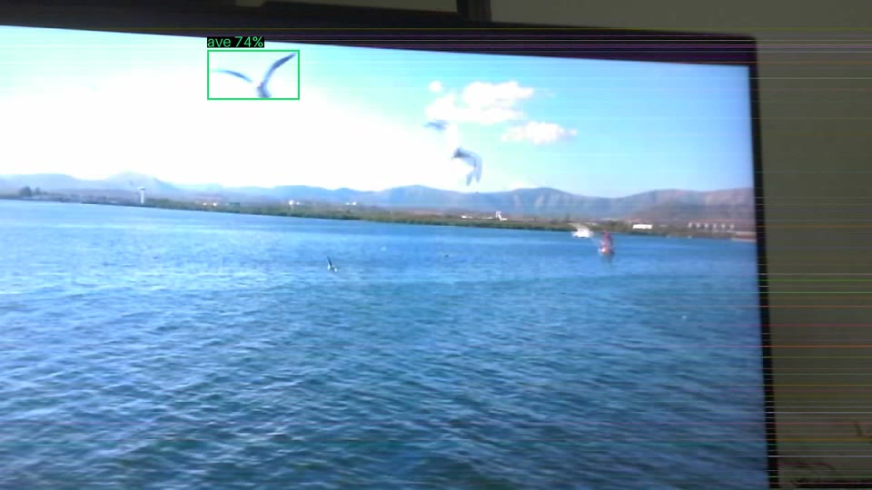
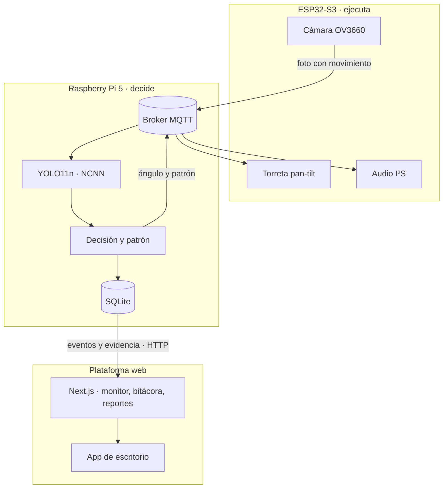
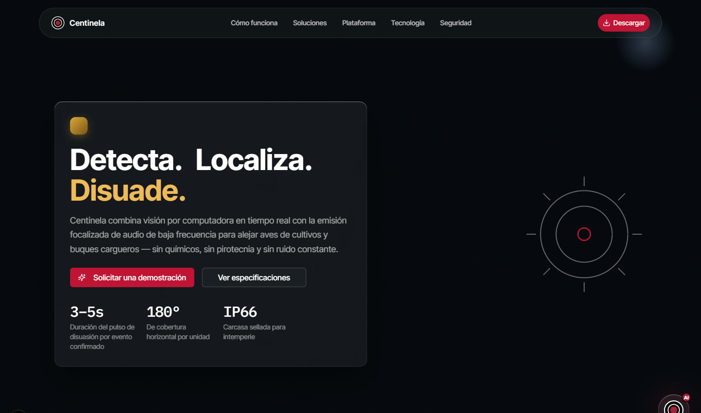
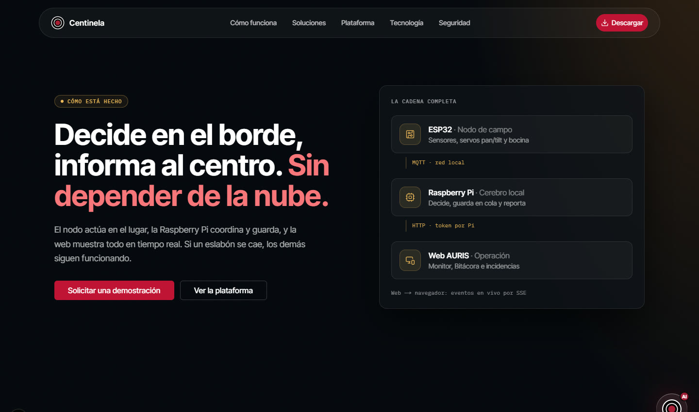
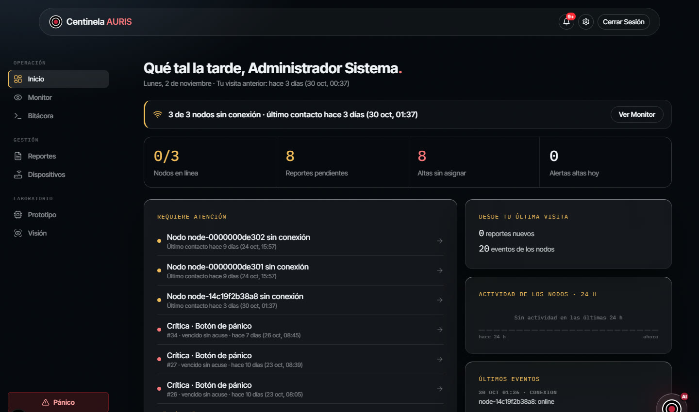
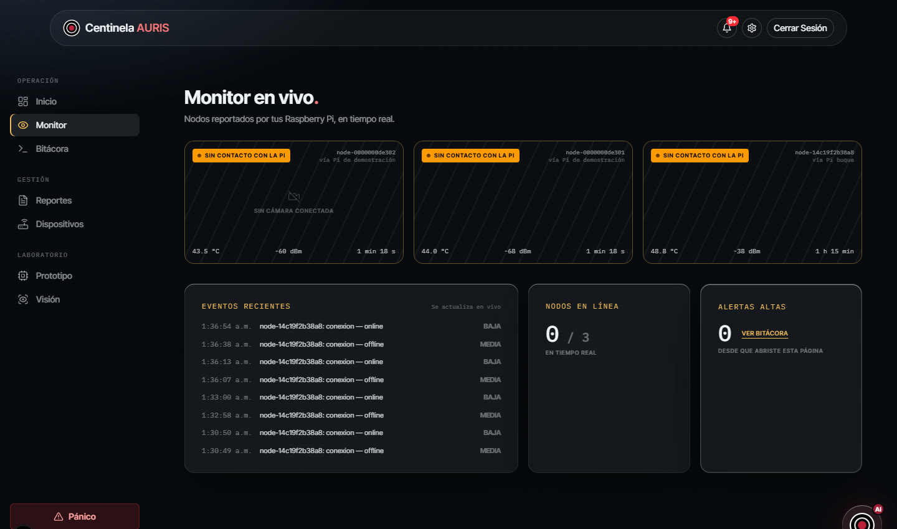
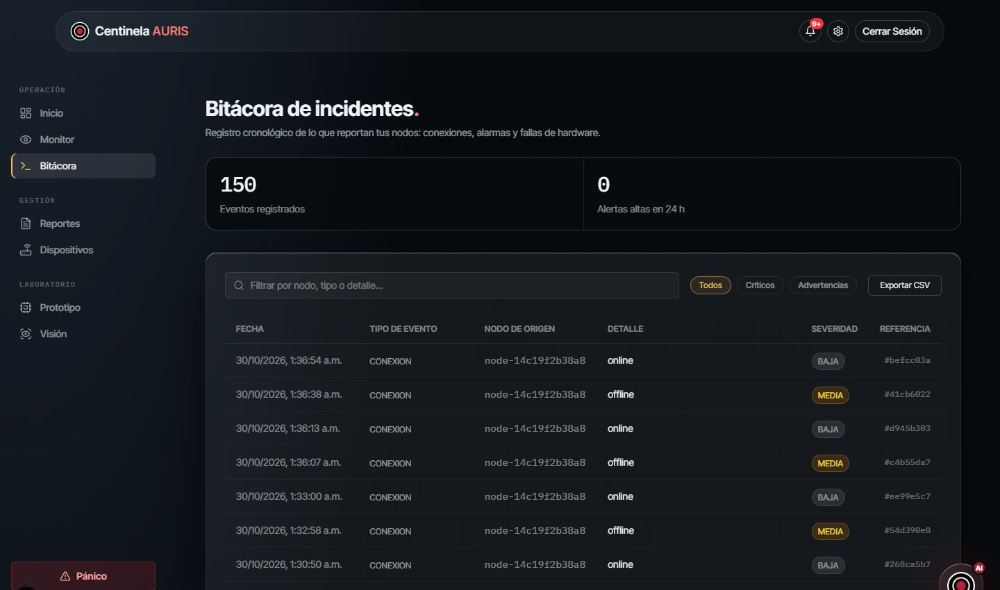
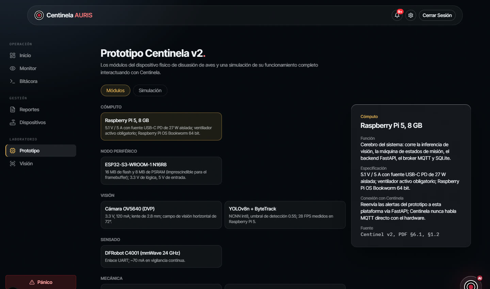

<div align="center">

# Centinel AURIS

**Sistema embebido de disuasión acústica adaptativa de aves con visión artificial y posicionamiento dinámico**

Proyecto modular · Ingeniería en Computación · Centro Universitario UNE · 2026



<sub>Simulación 3D de la plataforma web: la cámara identifica cada paloma, la torreta apunta, se emite el pulso y la bandada se dispersa.</sub>

</div>

---

## El problema

Las palomas, zanates y gorriones contaminan producto y dañan la infraestructura de bodegas, patios y terminales de carga. Además transmiten patógenos. Los ahuyentadores acústicos comerciales repiten siempre el mismo tono: funcionan la primera semana, pierden fuerza entre la segunda y la cuarta, y al segundo mes las aves ya no reaccionan (**habituación**). Subir el volumen no resuelve nada y molesta a todo el entorno.

## La propuesta

Centinel no suena todo el tiempo ni hacia todos lados. Hace cuatro cosas:

1. **Confirma** que hay un ave con visión artificial (YOLO11n) antes de actuar.
2. **Apunta**: una torreta de dos ejes gira hacia el ave.
3. **Varía** el estímulo: nunca repite el mismo patrón y así retrasa la habituación.
4. **Registra** cada evento con su foto en una plataforma web y en una app de escritorio.

<div align="center">


<sub>Foto real tomada por la cámara del nodo ESP32-S3 frente a un video de gaviotas: la Raspberry Pi detectó el ave (recuadro verde) y guardó la imagen como evidencia.</sub>
</div>

## Cómo funciona



Cada evento pasa por cuatro fases:

| Fase | Qué pasa |
|---|---|
| 1. Detección de zona | La cámara compara 1 foto por segundo; si cambia al menos 3 %, hay movimiento |
| 2. Reorientación | La Pi calcula el ángulo desde la posición del ave en la foto; el ESP32 mueve la torreta |
| 3. Confirmación visual | YOLO11n confirma el ave en 1–2 s (tres cuadros seguidos, filtro de estabilidad) |
| 4. Respuesta | Se emite un patrón acústico variable hacia el ave. Sin ave, la torreta vuelve a reposo (pan 90°, tilt 0°) |

### Política antihabituación

El patrón cambia en cinco dimensiones: **frecuencia, amplitud, duración, intervalo y posición**. Hay cinco familias de patrón y nunca se repiten las últimas tres. Las ráfagas duran de 0.5 a 3 s, con al menos 8 s entre ellas y como máximo 20 % del último minuto. La intensidad nunca se sube.

### Seguridad por diseño

Si se cae la red o falla el software, **la emisión se detiene**. Para eso hay resistencias pull-down en las salidas, un latido (heartbeat) periódico entre los nodos y el mensaje *Last Will* de MQTT, que avisa en cuanto un nodo se desconecta.

### Altavoz paramétrico (etapa siguiente)

El diseño final usa una matriz de 60 transductores ultrasónicos TCT40-16T. Emite una portadora de 40 kHz modulada en amplitud con el audio audible (0.3–6 kHz); el aire la demodula y forma un haz estrecho de 3°–4° (teórico) que llega al ave sin molestar alrededor.

```
Síntesis (ESP32-S3) → DAC I²S (PCM5102A) → Amplificador (TPA3116D2) → Acople (red LC) → Emisor (60 × TCT40)
s(t) = [1 + m·e(t)] · sen(2π · 40 000 · t)
```

## Plataforma web

| | |
|---|---|
|  |  |
| **Página principal** | **Tecnología: la cadena completa** |
|  |  |
| **Inicio: lo que requiere atención** | **Monitor en vivo de los nodos** |
|  |  |
| **Bitácora de eventos** | **Prototipo: módulos y simulación** |

Roles (Administrador, Operador, Usuario) con permisos por función, autenticación propia con JWT y 2FA, notificaciones, botón de pánico, reportes con seguimiento y un asistente (AURIS Chat). La consola se abre desde la app de escritorio o desde un teléfono.

## Estructura del repositorio

| Nivel | Carpeta | Tecnología |
|---|---|---|
| 1. Raspberry Pi 5: confirma el ave y decide la respuesta | `Centinela/edge/pi-gateway/` | Python, YOLO11n en NCNN, Mosquitto, SQLite |
| 2. ESP32-S3: cámara, servos y audio | `Centinela/edge/esp32-node/` | C++ / FreeRTOS, PlatformIO |
| 3. Plataforma web | `Centinela/` | Next.js 16, React 19, TypeScript, Prisma, SQLite |
| App de escritorio (Windows) | `Centinela-Desktop/` | Python, Qt |

## Cómo correrlo

### Web

Requiere Node.js 20 o superior.

```bash
cd Centinela
npm install
cp .env.example .env.local        # cada variable trae su explicación
npx prisma migrate dev
npx prisma db seed                # crea 3 cuentas de prueba (contraseña admin123; solo en desarrollo)
npm run build && npm start        # http://localhost:3000
```

`npm run demo:edge` simula un nodo y un gateway y manda eventos a la web, así que se puede probar sin hardware.

### Raspberry Pi y ESP32

Ver `Centinela/edge/pi-gateway/README.md` y `Centinela/edge/esp32-node/README.md`. El paso a paso para levantar todo en el hardware real está en `Centinela/edge/RUNBOOK.md`.

### Escritorio

Ver `Centinela-Desktop/README.md`.

### Pruebas

```bash
cd Centinela && npm test                                    # unitarias (Vitest)
cd Centinela/edge/pi-gateway && python -m pytest            # gateway
cd Centinela-Desktop && python -m pytest                    # escritorio
```

## Resultados (mediciones del 29 de octubre de 2026)

| Medición | Resultado |
|---|---|
| Inferencia en la Raspberry Pi 5 (NCNN) | **80 ms** por foto a 640 px (≈ 12 FPS) · **382 ms** a 1280 px (≈ 2.6 FPS) |
| Aves pequeñas o agrupadas | En una misma foto de gaviotas se pasó de **6 a 27** detectadas al subir a 1280 px |
| Palomas posadas (fotos de referencia) | **13 de 13** detectadas |
| Cámara real del nodo | Ave detectada con **58 %** de confianza y foto guardada como evidencia |

| Hipótesis | Meta | Estado |
|---|---|---|
| H1.1 Permanencia | ≥ 60 % menor que con tono fijo | Pendiente: experimento de campo de 8 semanas |
| H1.2 Habituación | Pendiente de habituación menor | Pendiente: experimento de campo |
| H1.3 Falsos disparos | ≥ 80 % menos que un sensor PIR | Pendiente |
| H1.4 Velocidad | ≥ 25 FPS y latencia total ≤ 1200 ms | Parcial: el sistema analiza 1 foto/s y solo infiere ante movimiento |
| H1.5 Puntería | Error ≤ 4.2° | Pendiente: torreta en instalación |
| H1.6 Silenciamiento ante fallas | 100 % | Reglas implementadas; faltan pruebas de inyección de fallos |

## Trabajo a futuro

- Medir mAP y latencia con la configuración final y correr 8 semanas de campo en 2 sitios.
- Construir la matriz paramétrica y medir su patrón de radiación.
- Redes de varios nodos y reentrenamiento para identificar especies.
- Aplicaciones: hogar, plantas y bodegas, puertos y campo (incluido el control de aves en buques de grano).

## Autores

**Gabriel Isaac Márquez Romo** · **Ángel David Munguía Zúñiga**
Asesora: Karla America Ayard Ramos · Centro Universitario UNE · Universidad de Especialidades

## Licencia

MIT, excepto `Centinela/edge/pi-gateway/`, que es AGPL-3.0 porque usa Ultralytics YOLO. Ver `Centinela/LICENSE`.
